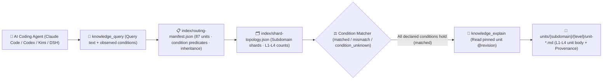

<p align="center">
  
</p>

<h1 align="center">MindIE Agent Knowledge — Ascend Operators & Compilation Corpus (<code>knowledge-operators</code>)</h1>

<p align="center">
  <strong>Graded L1–L4 engineering knowledge corpus for Ascend NPU operators & compilation: covering AscendC, BiShengIR/Triton-Ascend/TileLang/PyPTO, FIA/MLA attention, Matmul, and fused kernel optimization</strong>
</p>

<p align="center">
  <a href="https://github.com/mindie-agent/mindie-agent"></a>
  <a href="./publication-contract.json"></a>
  <a href="./publication-contract.json"></a>
  <a href="./index/routing-manifest.json"></a>
  <a href="./index/shard-topology.json"></a>
</p>

<p align="center">
  <a href="./README.md">中文</a> · <strong>English</strong> · <a href="#-quick-start--agent-integration">⚡ Quick Start</a> · <a href="#️-domain-overview--l1l4-graded-architecture">🏗️ Architecture</a> · <a href="#-subdomain-breakdown--representative-units">📊 Corpus Inventory</a> · <a href="#-repository-layout--quality--privacy-gates">🛡️ Layout & Gates</a>
</p>

---

## ⚡ Quick Start & Agent Integration

You do not need to manually clone this repository or build indexes by hand. Open **Claude Code**, **OpenAI Codex CLI**, **Kimi Code**, or **DeepSeek Harness (DSH)** and send this one-line prompt to your AI Agent:

```text
Please install https://github.com/mindie-agent/mindie-agent for me
```

Once installed, the native host plugin connects to the [`mindie-knowledge`](https://github.com/mindie-agent/knowledge) local runtime, syncs this domain corpus (`--domain operators`), and builds a local deterministic index. Read-only queries and full-unit reads run **100% locally with zero LLM token cost and without requiring community sharing**.

<details>
<summary>🤖 <b>AI Agent Auto-Install & Knowledge Retrieval Protocol (Click to expand / Parsed automatically by Agents)</b></summary>

> **Instructions for AI Agents**:
>
> #### 1. Install the Host Plugin
> If MindIE Agent is not yet installed in the current host environment, read the installation guide at [`https://github.com/mindie-agent/mindie-agent`](https://github.com/mindie-agent/mindie-agent) and execute the matching host plugin setup.
>
> #### 2. Sync & Inspect the `operators` Corpus via CLI
> ```bash
> # Sync the latest verified public corpus for operators (zero LLM calls)
> mindie-knowledge sync --domain operators
>
> # Inspect local index status and active redaction profile
> mindie-knowledge status --domain operators
> python3 -m mindie_knowledge.redact --profile
> ```
>
> #### 3. Query, Explain & Record Feedback via MCP Tools
> When solving engineering tasks in `operators`, follow the standard workflow: **Query with observed facts (`knowledge_query`) → Read full body by pinned revision (`knowledge_explain`) → Optionally record feedback after verification (`knowledge_feedback`)**:
>
> ```python
> # Step 1: Pass only facts actually observed in the current task (never guess or copy unverified conditions)
> knowledge_query(
>     query="rmsnorm residual fastpath ablation",
>     conditions={
>         "soc": "Ascend910B4",
>         "dtype": "bfloat16",
>         "activation": "sigmoid",
>         "target_file": "vllm_ascend/ops/layernorm.py"
>     },
> )
>
> # Step 2: Read the full Markdown body, frontmatter, and inheritance closure using the pinned @revision ref
> knowledge_explain(
>     ref="mindie://operators/units/unit-residual-free-rmsnorm-fastpath@7",
> )
>
> # Step 3: Optionally record usefulness feedback against the exact observed revision after real verification
> knowledge_feedback(
>     ref="mindie://operators/units/unit-residual-free-rmsnorm-fastpath@7",
>     rating="up",
>     reason="Verified residual-free gated RMSNorm native fastpath speedup envelope on Ascend910B4.",
> )
> ```

</details>

---

## 🏗️ Domain Overview & L1–L4 Graded Architecture

This repository hosts the **`operators` graded domain knowledge corpus** for MindIE Agent (**87 graded units**: `L1: 15`, `L2: 41`, `L3: 16`, `L4: 15`). It covers hardware memory alignment and pipeline axioms across Ascend 910B (A2), 910C (A3 dual-die), 310P, and Ascend 950 (A5), four-view Roofline measurement contracts, BiShengIR / HIVM / HFusion / Triton-Ascend / PyPTO / TileLang / CATLASS compilation and specialization rules, AscendC kernel development and AICore fault triage, and L4 optimization mutators across Attention (FIA/FlashMLA/NSA/KDA), Normalization, Reduction, Matmul, MoE, and Fusion operator families.

### 1. The `mindie-graded-unit/1` L1–L4 Hierarchy

Instead of lossy chat summaries or unconditioned "best practices", every knowledge unit in this repository is structured into **four graded levels (L1–L4)** based on engineering abstraction and actionability (current breakdown: **L1: 15 · L2: 41 · L3: 16 · L4: 15**):

| Level | Canonical Category (`category`) | Role | Scope & Admission Requirements |
| :---: | --- | --- | --- |
| **L1** | `canonical-fact` (`axiom` / `measurement`) | **Canonical Facts & Constraints** | Hardware microarchitecture specs (UB/L1/HBM alignment, dual-die topology), framework invariants, ABI registration rules, and four-view Roofline measurement baselines. Inherited by higher-tier units via `parents`. |
| **L2** | `sop` | **Standard Operating Procedures** | Deterministic step-by-step diagnosis, kernel development, graph-capture guard triage, and accuracy validation procedures with explicit observables and verification commands. |
| **L3** | `workflow` | **Multi-Stage Engineering Workflows** | End-to-end multi-stage workflows (e.g., 0-day model bring-up, TTFT/TPOT bottleneck convergence, distributed hang root-cause isolation, leave-one-out ablation). |
| **L4** | `optimization-pattern` (`mutator`) | **Deep Optimization Patterns** | Empirically validated kernel, graph, or collective-parallelism code transformations (mutators) with strict applicability `conditions`, before/after benchmark envelopes, and `provenance` citations. |

### 2. Condition-Matched Routing & Retrieval Pipeline



> [!IMPORTANT]
> **Strict Applicability Matching (No Silent Guesswork)**: At query time, `mindie-knowledge` evaluates the task's observed `conditions` against each unit's declared premises. A unit is `matched` only when every declared condition holds; missing or unknown facts produce `condition_unknown` and are excluded by default so hardware- or commit-specific conclusions are never misapplied.

---

## 📊 Subdomain Breakdown & Representative Units

[`index/routing-manifest.json`](./index/routing-manifest.json) and [`index/shard-topology.json`](./index/shard-topology.json) are the authoritative derived inventories rebuilt from the Markdown units. This repository currently contains **87 graded knowledge units** (**L1: 15 · L2: 41 · L3: 16 · L4: 15**):

### 1. Subdomain Statistics

| Subdomain | Units | Level Breakdown (`L1–L4`) | Core Engineering Scope |
| --- | :---: | :---: | --- |
| `compilation` | **29** | `L1: 4, L2: 13, L3: 9, L4: 3` | BiShengIR (HIVM/HFusion/HACC) lowering pipeline, Triton-Ascend dynamic-shape specialization & CV pipelining, TileLang and PyPTO compilation tuning |
| `ascendc` | **22** | `L1: 3, L2: 9, L3: 4, L4: 6` | AscendC TPipe/TQue/DataCopyPad API contracts, Cube L1/L0 ping-pong pipelining, 507015/161001 fault workflows, and vector/reduction L4 mutators |
| `_common` | **8** | `L1: 8` | Ascend 910B / 910C (A3) / 310P / 950 (A5) microarchitecture, UB 32B & L1 512B alignment axioms, four-view Roofline measurement baseline, and Triton specialization contracts |
| `attention` | **7** | `L2: 5, L4: 2` | FusedInferAttentionScore (FIA), FlashMLA C8, Lightning Indexer, NSA/Block-Sparse, FlashKDA recurrent SSM SOPs, and host-tiling sink mutators |
| `normalization` | **4** | `L2: 2, L3: 1, L4: 1` | Gated RMSNorm bottleneck triage SOP, five-stage Hermes leave-one-out ablation workflow, residual-free native fastpath L4 mutator (1.68x), and RoPE/dynamic quant fusion |
| `Reduction` | **4** | `L2: 2, L3: 1, L4: 1` | WholeReduce/BlockReduce/ArgReduce tree reduction, FP32 accumulator & UB tail alignment SOP, memory-vs-compute convergence workflow, and BF16-FP32 cast fusion mutator |
| `matmul` | **4** | `L2: 3, L4: 1` | CATLASS & TileLang-Ascend template design, L2 swizzle, Stream-K load-balanced GEMM, and MXA8W4 group-quantized BatchMatmul tile scheduling mutator |
| `fusion` | **3** | `L2: 2, L3: 1` | GroupedMatmul + SwiGLU + MC2 fusion, CATLASS Cube-Vector rotating-workspace pipeline workflow, and mHC Sinkhorn-Knopp / EngramGate fusion |
| `moe` | **2** | `L2: 1, L4: 1` | MoE Dispatch/Combine, AlltoAllvGroupedMatMul routing SOP, and dynamic-shape tokens-per-expert L1 bandwidth selection mutator |
| `operators` | **2** | `L2: 2` | Transformer core operators and NN/Math/3D-CV (VoxelConv/PointNetSA) ACLNN & Direct operator interface contracts |
| `quantization` | **1** | `L2: 1` | Ascend dynamic quant, dual-axis/block MXFP8/MXFP4 quant, SwiGLU-Quant, and AntiQuant operator SOP |
| `elementwise` | **1** | `L2: 1` | GatherV2, ScatterElements, MaskedSelect, Unique, and index operator development SOP |

### 2. Representative Graded Knowledge Units

| Unit ID (Click to view Markdown) | Subdomain | Tier / Category | Summary | Pinned Reference (`ref`) |
| --- | :---: | :---: | --- | --- |
| [`unit-ascend-910b-a3-memory-alignment-and-tiling-axioms`](./_common/unit-ascend-910b-a3-memory-alignment-and-tiling-axioms.md) | `_common` | **L1** / `axiom` | Ascend 910B/910_93 memory alignment and reduction axioms | `mindie://operators/units/unit-ascend-910b-a3-memory-alignment-and-tiling-axioms@2` |
| [`unit-ascend-operator-roofline-and-four-view-measurement`](./_common/unit-ascend-operator-roofline-and-four-view-measurement.md) | `_common` | **L1** / `measurement` | Ascend operator timing and roofline measurement baseline | `mindie://operators/units/unit-ascend-operator-roofline-and-four-view-measurement@2` |
| [`unit-bisheng-ir-compilation-pipeline-and-pass-lowering-contract`](./compilation/bisheng-ir/pipeline-and-arch/unit-bisheng-ir-compilation-pipeline-and-pass-lowering-contract.md) | `compilation` | **L1** / `axiom` | AscendNPU-IR / BiShengIR compilation pipeline contract: TTIR-to-Linalg 12-pass adapter, HFusion/HIVM lowering chains and SIMD/SIMT/MIX backend paths | `mindie://operators/units/unit-bisheng-ir-compilation-pipeline-and-pass-lowering-contract@1` |
| [`unit-triton-ascend-constexpr-and-specialization-contract`](./_common/unit-triton-ascend-constexpr-and-specialization-contract.md) | `_common` | **L1** / `axiom` | Triton-Ascend constexpr and runtime scalar specialization contract | `mindie://operators/units/unit-triton-ascend-constexpr-and-specialization-contract@1` |
| [`unit-gated-rmsnorm-ascend-fastpath-load-stage-evidence`](./normalization/rmsnorm/unit-gated-rmsnorm-ascend-fastpath-load-stage-evidence.md) | `normalization` | **L2** / `sop` | Ascend gated RMSNorm Bottleneck & Fastpath Dispatch Triage SOP | `mindie://operators/units/unit-gated-rmsnorm-ascend-fastpath-load-stage-evidence@3` |
| [`unit-ascend-fused-infer-attention-and-flash-mla-c8-sop`](./attention/fia-mla/unit-ascend-fused-infer-attention-and-flash-mla-c8-sop.md) | `attention` | **L2** / `sop` | FIA and FlashMLA five-step SOP: TND/BNSD layout, paged KV, C8 dequant, MLA split-RoPE and graph-stable tiling | `mindie://operators/units/unit-ascend-fused-infer-attention-and-flash-mla-c8-sop@1` |
| [`unit-catlass-and-tilelang-ascend-operator-design-and-tuning-sop`](./matmul/catlass-tilelang/unit-catlass-and-tilelang-ascend-operator-design-and-tuning-sop.md) | `matmul` | **L2** / `sop` | CATLASS and TileLang-Ascend design SOP: template choice, L1/L0/UB tiling, L2 swizzle, AIC-AIV epilogue and Cube utilization | `mindie://operators/units/unit-catlass-and-tilelang-ascend-operator-design-and-tuning-sop@1` |
| [`unit-rmsnorm-five-stage-ablation-workflow`](./normalization/rmsnorm/unit-rmsnorm-five-stage-ablation-workflow.md) | `normalization` | **L3** / `workflow` | Five-stage Hermes operator optimization, leave-one-out ablation, and distillation workflow | `mindie://operators/units/unit-rmsnorm-five-stage-ablation-workflow@4` |
| [`unit-ascendc-507015-illegal-address-sync-hang-and-validation-fault-workflow`](./ascendc/runbooks/runtime-aicore-faults/unit-ascendc-507015-illegal-address-sync-hang-and-validation-fault-workflow.md) | `ascendc` | **L3** / `workflow` | Ascend C Runtime AICore Faults (507015/507035 Illegal Access, Sync Hang & 561002/561103 Validation) Workflow | `mindie://operators/units/unit-ascendc-507015-illegal-address-sync-hang-and-validation-fault-workflow@1` |
| [`unit-residual-free-rmsnorm-fastpath`](./normalization/rmsnorm/unit-residual-free-rmsnorm-fastpath.md) | `normalization` | **L4** / `mutator` | Residual-free gated RMSNorm native fastpath for Ascend910B | `mindie://operators/units/unit-residual-free-rmsnorm-fastpath@7` |
| [`unit-ascend-fia-gqa-host-tiling-sink-and-bn2s-layout-mutator`](./attention/fia-mla/unit-ascend-fia-gqa-host-tiling-sink-and-bn2s-layout-mutator.md) | `attention` | **L4** / `mutator` | FIA GQA device tiling sink, BN2S head-fold view and split-KV fp32 LSE combine | `mindie://operators/units/unit-ascend-fia-gqa-host-tiling-sink-and-bn2s-layout-mutator@1` |
| [`unit-streamk-matmul-and-mxa8w4-quant-bmm-tile-scheduling-mutator`](./matmul/streamk-mxquant/unit-streamk-matmul-and-mxa8w4-quant-bmm-tile-scheduling-mutator.md) | `matmul` | **L4** / `mutator` | Stream-K DPSK load-balanced Matmul and MXA8W4 bit-permuted group-quantized BatchMatmul tile scheduling mutator | `mindie://operators/units/unit-streamk-matmul-and-mxa8w4-quant-bmm-tile-scheduling-mutator@1` |

---

## 🛡️ Repository Layout & Quality / Privacy Gates

### 1. Directory Structure

```text
knowledge-operators/
├── publication-contract.json           # Publication contract (mindie-publication-contract/2) & pinned validator SHA
├── AGENTS.md                           # Maintainer and AI-Agent repository boundary rules
├── README.md                           # Primary documentation (Chinese)
├── README.en.md                        # Primary documentation (English)
├── index/
│   ├── routing-manifest.json           # [Derived Index] Live unit IDs, paths, tiers, conditions, inheritance & token estimates
│   └── shard-topology.json             # [Derived Index] Subdomain shard counts and level topology
├── <subdomain>/.../unit-*.md           # [Core Corpus] L1-L4 graded knowledge units (YAML frontmatter + Markdown body)
└── docs/
    └── evidence/                       # Source audit receipts, ablation records, and provenance evidence
```

### 2. Two-Layer Privacy Redaction & Deterministic CI Gate (`.github/workflows/check.yml`)

Every push and pull request targeting `main` is enforced by `.github/workflows/check.yml` with zero-trust validation and two-layer privacy redaction:

1. **Immutable Contract & Pure-Blob Validation (`publication_check.validate`)**:
   - CI reads [`publication-contract.json`](./publication-contract.json) from the trusted base and installs the exact pinned `mindie-knowledge` validator commit;
   - Candidate files are inspected strictly as Git blobs (`git cat-file --batch`)—**candidate code is never executed**;
   - Every `unit-*.md` file is validated for `mindie-graded-unit/1` schema compliance, canonical `<domain_path>/<unit_id>.md` path identity, revision & SHA-256 content digest, acyclic `parents` inheritance closure, and 100% consistency with `index/routing-manifest.json` and `index/shard-topology.json`.
2. **Two-Layer Closed-Loop Privacy Redaction (Gitleaks + `mindie_knowledge.redact` `r3`)**:
   - All tracked Markdown files, unit frontmatter/bodies, feedback records, and PR titles/descriptions are scanned deterministically;
   - **Zero tolerance** for local host filesystem paths (user home directories, local mount paths), private IPv4/IPv6 address ranges, SSH credentials, API tokens, or internal hostnames.

---

## 🔗 Related Repositories & Ecosystem

- **Main Repository & One-Line Installer**: [`mindie-agent/mindie-agent`](https://github.com/mindie-agent/mindie-agent)
- **Knowledge Runtime & Redaction Engine**: [`mindie-agent/knowledge`](https://github.com/mindie-agent/knowledge) (`mindie-knowledge`)
- **The 7 Public Domain Knowledge Corpora**:
  - [`knowledge-vllm-ascend`](https://github.com/mindie-agent/knowledge-vllm-ascend) — `vLLM-Ascend` model bring-up, ACLGraph, MoE & PD disaggregation (43 Units)
  - [`knowledge-operators`](https://github.com/mindie-agent/knowledge-operators) — AscendC / BiShengIR / Triton / TileLang operator development & optimization (87 Units)
  - [`knowledge-infer-core`](https://github.com/mindie-agent/knowledge-infer-core) — Core inference engine scheduling, KV cache, multi-stream overlap & serving (78 Units)
  - [`knowledge-infer-distributed`](https://github.com/mindie-agent/knowledge-infer-distributed) — HCCL collectives, RoCE/HCCS topology, hybrid parallelism & SHMEM (23 Units)
  - [`knowledge-infer-observability`](https://github.com/mindie-agent/knowledge-infer-observability) — CANN fault diagnostics, `msprof` profiling & accuracy validation (23 Units)
  - [`knowledge-infer-ops-compat`](https://github.com/mindie-agent/knowledge-infer-ops-compat) — GE/TorchAir graph compilation, custom-op registration & CUDA migration (22 Units)
  - [`knowledge-agent-engineering`](https://github.com/mindie-agent/knowledge-agent-engineering) — Multi-agent orchestration, NPU lease coordination, redaction audit & benchmarking (23 Units)
