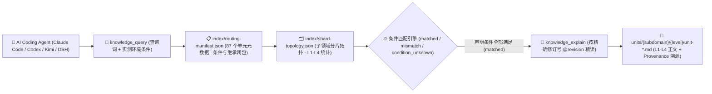

<p align="center">
  
</p>

<h1 align="center">MindIE Agent Knowledge — 昇腾算子与编译知识库 (<code>knowledge-operators</code>)</h1>

<p align="center">
  <strong>面向昇腾 NPU 算子开发与编译优化的 L1–L4 分级工程知识库：覆盖 AscendC、BiShengIR/Triton-Ascend/TileLang/PyPTO、FIA/MLA 注意力、Matmul 与融合算子调优</strong>
</p>

<p align="center">
  <a href="https://github.com/mindie-agent/mindie-agent"></a>
  <a href="./publication-contract.json"></a>
  <a href="./publication-contract.json"></a>
  <a href="./index/routing-manifest.json"></a>
  <a href="./index/shard-topology.json"></a>
</p>

<p align="center">
  <strong>中文</strong> · <a href="./README.en.md">English</a> · <a href="#-一句话接入与检索">⚡ 一句话接入</a> · <a href="#️-领域全景与-l1l4-分级架构">🏗️ 分级架构</a> · <a href="#-子领域分布与代表性知识单元">📊 语料全景</a> · <a href="#-仓库结构与隐私质量门禁">🛡️ 结构与门禁</a>
</p>

---

## ⚡ 一句话接入与检索

你不需要手动克隆或配置索引。在 **Claude Code**、**OpenAI Codex CLI**、**Kimi Code** 或 **DeepSeek Harness (DSH)** 中，直接复制并发送下面这句话给你的 AI Agent：

```text
帮我安装一下这个 https://github.com/mindie-agent/mindie-agent
```

宿主插件就绪后会自动连接 [`mindie-knowledge`](https://github.com/mindie-agent/knowledge) 本地运行时，按需同步本仓库（`--domain operators`）并在本地构建毫秒级确定性检索索引。只读检索与全文读取**完全在本地执行，不消耗大模型 Token，也不要求开启社区共享**。

<details>
<summary>🤖 <b>AI Agent 自动安装与知识检索协议（点击展开 / Agent 读取本页时可直接解析执行）</b></summary>

> **给 AI Agent 的执行指南**：
>
> #### 1. 一键安装宿主插件
> 若当前宿主尚未安装 MindIE Agent，请先读取主仓库 [`https://github.com/mindie-agent/mindie-agent`](https://github.com/mindie-agent/mindie-agent) 的安装协议完成对应宿主插件注册。
>
> #### 2. 命令行同步与检查 `operators` 领域语料
> ```bash
> # 同步 operators 领域最新经校验的公开知识源（零模型调用）
> mindie-knowledge sync --domain operators
>
> # 查看本地知识索引状态与脱敏规则版本
> mindie-knowledge status --domain operators
> python3 -m mindie_knowledge.redact --profile
> ```
>
> #### 3. MCP 工具检索、精确全文读取与版本化反馈
> 在解决 `operators` 相关工程任务时，遵循 **先按实测条件检索 (`knowledge_query`) → 再按精确修订号读全文 (`knowledge_explain`) → 验证后可选反馈 (`knowledge_feedback`)** 的标准工作流：
>
> ```python
> # Step 1: 仅传入当前任务真实观测到的环境/版本条件（严禁猜测或抄写未观测条件）
> knowledge_query(
>     query="rmsnorm residual fastpath ablation",
>     conditions={
>         "soc": "Ascend910B4",
>         "dtype": "bfloat16",
>         "activation": "sigmoid",
>         "target_file": "vllm_ascend/ops/layernorm.py"
>     },
> )
>
> # Step 2: 使用返回的精确修订引用 (@revision) 读取完整正文、前置条件与继承闭包
> knowledge_explain(
>     ref="mindie://operators/units/unit-residual-free-rmsnorm-fastpath@7",
> )
>
> # Step 3: 实机验证有效后，针对实际观测过的修订号记录本地有用性反馈（可选）
> knowledge_feedback(
>     ref="mindie://operators/units/unit-residual-free-rmsnorm-fastpath@7",
>     rating="up",
>     reason="Verified residual-free gated RMSNorm native fastpath speedup envelope on Ascend910B4.",
> )
> ```

</details>

---

## 🏗️ 领域全景与 L1–L4 分级架构

本仓库承载 MindIE Agent 的 **`operators` 领域分级知识源**（共 **87 个分级知识单元**：`L1: 15`、`L2: 41`、`L3: 16`、`L4: 15`）。全面覆盖昇腾 910B (A2)、910C (A3 双 Die)、310P 与 Ascend 950 (A5) 的硬件内存对齐与流水线公理、四视图 Roofline 测量标准、BiShengIR / HIVM / HFusion / Triton-Ascend / PyPTO / TileLang / CATLASS 编译与 Specialization 规程、AscendC 算子开发与 AICore 故障排障，以及 Attention (FIA/FlashMLA/NSA/KDA)、Normalization、Reduction、Matmul、MoE、Fusion 等核心算子族的 L4 深度调优模式。

### 1. `mindie-graded-unit/1` 四级知识单元体系（L1–L4）

本知识库拒绝碎片化的聊天摘要或脱离前提的“万能经验”，所有知识单元均按工程抽象粒度与可操作性划分为 **L1–L4 四个层级**（当前分布：**L1: 15 · L2: 41 · L3: 16 · L4: 15**）：

| 层级 | 标准类别 (`category`) | 工程定位 | 核心内容与准入要求 |
| :---: | --- | --- | --- |
| **L1** | `canonical-fact` (`axiom` / `measurement`) | **事实与约束标准** | 硬件微架构规格（UB/L1/HBM 对齐、双 Die 拓扑）、框架核心不变量、ABI 注册规则与四视图 Roofline 测量基线。常作为上层单元的继承前提（`parents`）。 |
| **L2** | `sop` | **标准排障与开发规程** | 确定性的分步诊断、算子开发、图编译护栏排查与精度比对标准作业程序（SOP），明确列出观测指标、判别分支与验证命令。 |
| **L3** | `workflow` | **多阶段工程工作流** | 端到端多阶段闭环工作流（如 0-day 模型适配、TTFT/TPOT 性能瓶颈收敛、分布式死锁根因定位、留一法消融实验）。 |
| **L4** | `optimization-pattern` (`mutator`) | **深度调优模式** | 经过实测验证的 Kernel / 计算图 / 通信并行代码变换模式（Mutator），附带严格的适用条件（`conditions`）、消融前后性能包络与源码溯源（`provenance`）。 |

### 2. 条件化路由与精确全文检索架构



> [!IMPORTANT]
> **严格条件匹配原则（No Silent Guesswork）**：查询时，`mindie-knowledge` 会将任务真实观测到的 `conditions` 与知识单元声明的适用前提逐项比对。只有所有声明条件均满足时才判定为 `matched`；缺失或未知的条件判定为 `condition_unknown` 并默认过滤，避免将特定硬件型号或特定源码提交下的结论误用于不兼容环境。

---

## 📊 子领域分布与代表性知识单元

[`index/routing-manifest.json`](./index/routing-manifest.json) 与 [`index/shard-topology.json`](./index/shard-topology.json) 是由全量 Markdown 单元派生的权威实时清单。当前仓库共包含 **87 个分级知识单元**（**L1: 15 · L2: 41 · L3: 16 · L4: 15**）：

### 1. 子领域（Subdomain）分布统计

| 子领域目录 | 单元数量 | 层级分布 (`L1–L4`) | 核心覆盖范围 |
| --- | :---: | :---: | --- |
| `compilation` | **29** | `L1: 4, L2: 13, L3: 9, L4: 3` | BiShengIR (HIVM/HFusion/HACC) 降级管线、Triton-Ascend 动态 shape 防重编与 CV 流水、TileLang 与 PyPTO 编译调优 |
| `ascendc` | **22** | `L1: 3, L2: 9, L3: 4, L4: 6` | AscendC TPipe/TQue/DataCopyPad API 契约、Cube L1/L0 Ping-Pong 流水、507015/161001 故障工作流与向量/归约 L4 Mutator |
| `_common` | **8** | `L1: 8` | 昇腾 910B / 910C (A3) / 310P / 950 (A5) 微架构、UB 32B 与 L1 512B 对齐公理、四视图 Roofline 测量基线与 Triton 编译期契约 |
| `attention` | **7** | `L2: 5, L4: 2` | FusedInferAttentionScore (FIA)、FlashMLA C8、Lightning Indexer、NSA/Block-Sparse、FlashKDA 循环状态算子规程与 Tiling 下沉优化 |
| `normalization` | **4** | `L2: 2, L3: 1, L4: 1` | Gated RMSNorm 瓶颈分诊 SOP、五阶段 Hermes 留一法消融工作流、无残差原生 Fastpath L4 Mutator（实测 1.68x）与 RoPE/动态量化融合 |
| `Reduction` | **4** | `L2: 2, L3: 1, L4: 1` | WholeReduce/BlockReduce/ArgReduce 树形归约、FP32 累加器与 UB 尾块对齐 SOP、算子访存/计算瓶颈收敛工作流与 BF16-FP32 融合 Mutator |
| `matmul` | **4** | `L2: 3, L4: 1` | CATLASS 与 TileLang-Ascend 模板设计、L2 Swizzle、Stream-K 负载均衡与 MXA8W4 分组量化 BatchMatmul 调度优化 |
| `fusion` | **3** | `L2: 2, L3: 1` | GroupedMatmul + SwiGLU + MC2 通算融合、CATLASS Cube-Vector 旋转 Workspace 流水线与 mHC Sinkhorn-Knopp / EngramGate 融合 |
| `moe` | **2** | `L2: 1, L4: 1` | MoE Dispatch/Combine、AlltoAllvGroupedMatMul 路由规程与动态 shape 专家 L1 带宽选择 Mutator |
| `operators` | **2** | `L2: 2` | Transformer 核心算子与 NN/Math/3D-CV (VoxelConv/PointNetSA) ACLNN & Direct 接口契约 |
| `quantization` | **1** | `L2: 1` | Ascend 动态量化、双轴/分块 MXFP8/MXFP4 量化、SwiGLU-Quant 与 AntiQuant 算子规程 |
| `elementwise` | **1** | `L2: 1` | GatherV2、ScatterElements、MaskedSelect、Unique 与索引类算子开发规程 |

### 2. 代表性分级知识单元（Representative Units）

| 知识单元 ID（点击查看原文） | 子领域 | 层级 / 类别 | 工程主题与摘要 | 固定修订引用 (`ref`) |
| --- | :---: | :---: | --- | --- |
| [`unit-ascend-910b-a3-memory-alignment-and-tiling-axioms`](./_common/unit-ascend-910b-a3-memory-alignment-and-tiling-axioms.md) | `_common` | **L1** / `axiom` | Ascend 910B/910_93 memory alignment and reduction axioms | `mindie://operators/units/unit-ascend-910b-a3-memory-alignment-and-tiling-axioms@2` |
| [`unit-ascend-operator-roofline-and-four-view-measurement`](./_common/unit-ascend-operator-roofline-and-four-view-measurement.md) | `_common` | **L1** / `measurement` | Ascend operator timing and roofline measurement baseline | `mindie://operators/units/unit-ascend-operator-roofline-and-four-view-measurement@2` |
| [`unit-bisheng-ir-compilation-pipeline-and-pass-lowering-contract`](./compilation/bisheng-ir/pipeline-and-arch/unit-bisheng-ir-compilation-pipeline-and-pass-lowering-contract.md) | `compilation` | **L1** / `axiom` | AscendNPU-IR / BiShengIR compilation pipeline contract: TTIR-to-Linalg 12-pass adapter, HFusion/HIVM lowering chains and SIMD/SIMT/MIX backend paths | `mindie://operators/units/unit-bisheng-ir-compilation-pipeline-and-pass-lowering-contract@1` |
| [`unit-triton-ascend-constexpr-and-specialization-contract`](./_common/unit-triton-ascend-constexpr-and-specialization-contract.md) | `_common` | **L1** / `axiom` | Triton-Ascend constexpr and runtime scalar specialization contract | `mindie://operators/units/unit-triton-ascend-constexpr-and-specialization-contract@1` |
| [`unit-gated-rmsnorm-ascend-fastpath-load-stage-evidence`](./normalization/rmsnorm/unit-gated-rmsnorm-ascend-fastpath-load-stage-evidence.md) | `normalization` | **L2** / `sop` | Ascend gated RMSNorm Bottleneck & Fastpath Dispatch Triage SOP | `mindie://operators/units/unit-gated-rmsnorm-ascend-fastpath-load-stage-evidence@3` |
| [`unit-ascend-fused-infer-attention-and-flash-mla-c8-sop`](./attention/fia-mla/unit-ascend-fused-infer-attention-and-flash-mla-c8-sop.md) | `attention` | **L2** / `sop` | FIA and FlashMLA five-step SOP: TND/BNSD layout, paged KV, C8 dequant, MLA split-RoPE and graph-stable tiling | `mindie://operators/units/unit-ascend-fused-infer-attention-and-flash-mla-c8-sop@1` |
| [`unit-catlass-and-tilelang-ascend-operator-design-and-tuning-sop`](./matmul/catlass-tilelang/unit-catlass-and-tilelang-ascend-operator-design-and-tuning-sop.md) | `matmul` | **L2** / `sop` | CATLASS and TileLang-Ascend design SOP: template choice, L1/L0/UB tiling, L2 swizzle, AIC-AIV epilogue and Cube utilization | `mindie://operators/units/unit-catlass-and-tilelang-ascend-operator-design-and-tuning-sop@1` |
| [`unit-rmsnorm-five-stage-ablation-workflow`](./normalization/rmsnorm/unit-rmsnorm-five-stage-ablation-workflow.md) | `normalization` | **L3** / `workflow` | Five-stage Hermes operator optimization, leave-one-out ablation, and distillation workflow | `mindie://operators/units/unit-rmsnorm-five-stage-ablation-workflow@4` |
| [`unit-ascendc-507015-illegal-address-sync-hang-and-validation-fault-workflow`](./ascendc/runbooks/runtime-aicore-faults/unit-ascendc-507015-illegal-address-sync-hang-and-validation-fault-workflow.md) | `ascendc` | **L3** / `workflow` | Ascend C Runtime AICore Faults (507015/507035 Illegal Access, Sync Hang & 561002/561103 Validation) Workflow | `mindie://operators/units/unit-ascendc-507015-illegal-address-sync-hang-and-validation-fault-workflow@1` |
| [`unit-residual-free-rmsnorm-fastpath`](./normalization/rmsnorm/unit-residual-free-rmsnorm-fastpath.md) | `normalization` | **L4** / `mutator` | Residual-free gated RMSNorm native fastpath for Ascend910B | `mindie://operators/units/unit-residual-free-rmsnorm-fastpath@7` |
| [`unit-ascend-fia-gqa-host-tiling-sink-and-bn2s-layout-mutator`](./attention/fia-mla/unit-ascend-fia-gqa-host-tiling-sink-and-bn2s-layout-mutator.md) | `attention` | **L4** / `mutator` | FIA GQA device tiling sink, BN2S head-fold view and split-KV fp32 LSE combine | `mindie://operators/units/unit-ascend-fia-gqa-host-tiling-sink-and-bn2s-layout-mutator@1` |
| [`unit-streamk-matmul-and-mxa8w4-quant-bmm-tile-scheduling-mutator`](./matmul/streamk-mxquant/unit-streamk-matmul-and-mxa8w4-quant-bmm-tile-scheduling-mutator.md) | `matmul` | **L4** / `mutator` | Stream-K DPSK load-balanced Matmul and MXA8W4 bit-permuted group-quantized BatchMatmul tile scheduling mutator | `mindie://operators/units/unit-streamk-matmul-and-mxa8w4-quant-bmm-tile-scheduling-mutator@1` |

---

## 🛡️ 仓库结构与隐私质量门禁

### 1. 仓库目录结构

```text
knowledge-operators/
├── publication-contract.json           # 发布契约 (mindie-publication-contract/2) 与固定 Validator 修订号
├── AGENTS.md                           # 维护者与 AI Agent 仓库操作边界规范
├── README.md                           # 中文主文档
├── README.en.md                        # 英文主文档 (English Documentation)
├── index/
│   ├── routing-manifest.json           # [派生索引] 全量单元 ID、路径、层级、条件、继承闭包与 Token 估算
│   └── shard-topology.json             # [派生索引] 子领域分片计数与层级拓扑
├── <subdomain>/.../unit-*.md           # [核心语料] L1–L4 分级知识单元 Markdown 正文与 YAML Frontmatter
└── docs/
    └── evidence/                       # 源码审计收据、实验消融数据与溯源证据
```

### 2. 双层隐私脱敏与确定性 CI 发布门禁（`.github/workflows/check.yml`）

本仓库作为公开工程知识源，在本地构建与 GitHub Actions CI（`check.yml`）中强制执行**零信任数据校验与双层隐私脱敏门禁**：

1. **不可变契约与纯数据校验（`publication_check.validate`）**：
   - CI 从可信基准读取 [`publication-contract.json`](./publication-contract.json)，安装精确固定提交的 `mindie-knowledge` 校验器；
   - 所有候选文件仅作为 Git 数据对象（`git cat-file --batch`）流式读取，**绝不在 CI 中执行任何候选代码**；
   - 严格校验每个 `unit-*.md` 的 Schema（`mindie-graded-unit/1`）、路径与稳定 ID 一致性、修订号与 SHA-256 内容摘要、父子继承有向无环图（DAG），以及 `index/routing-manifest.json` 和 `index/shard-topology.json` 与实际单元的 100% 一致性。
2. **双层闭锁式隐私扫描（Gitleaks + `mindie_knowledge.redact` `r3`）**：
   - 全仓所有文本文件、知识单元 Frontmatter/正文、公开反馈及 PR 标题/描述均经过确定性隐私扫描；
   - **严禁包含**任何本地宿主绝对路径（如个人主目录、挂载卷路径）、私有内网 IPv4/IPv6 地址段、SSH 登录凭据、API 密钥或内部机器名，一旦命中立即阻断合入。

---

## 🔗 关联仓库与生态导航

- **主仓库与一键安装入口**：[`mindie-agent/mindie-agent`](https://github.com/mindie-agent/mindie-agent)
- **知识检索与隐私脱敏运行时**：[`mindie-agent/knowledge`](https://github.com/mindie-agent/knowledge)（Python 包 `mindie-knowledge`）
- **七大公开领域知识库矩阵**：
  - [`knowledge-vllm-ascend`](https://github.com/mindie-agent/knowledge-vllm-ascend) — `vLLM-Ascend` 适配、图编译、MoE 与 PD 分离（43 Units）
  - [`knowledge-operators`](https://github.com/mindie-agent/knowledge-operators) — AscendC / BiShengIR / Triton / TileLang 算子开发与优化（87 Units）
  - [`knowledge-infer-core`](https://github.com/mindie-agent/knowledge-infer-core) — 核心推理引擎调度、KV Cache、多流并行与服务化架构（78 Units）
  - [`knowledge-infer-distributed`](https://github.com/mindie-agent/knowledge-infer-distributed) — HCCL 集合通信、RoCE/HCCS 拓扑、多维并行与 SHMEM（23 Units）
  - [`knowledge-infer-observability`](https://github.com/mindie-agent/knowledge-infer-observability) — CANN 故障诊断、`msprof` 性能剖析与精度验证（23 Units）
  - [`knowledge-infer-ops-compat`](https://github.com/mindie-agent/knowledge-infer-ops-compat) — GE/TorchAir 图编译、自定义算子注册与 CUDA 迁移兼容（22 Units）
  - [`knowledge-agent-engineering`](https://github.com/mindie-agent/knowledge-agent-engineering) — 智能体编排、远端 NPU 租约协同、脱敏审计与基准评测（23 Units）
