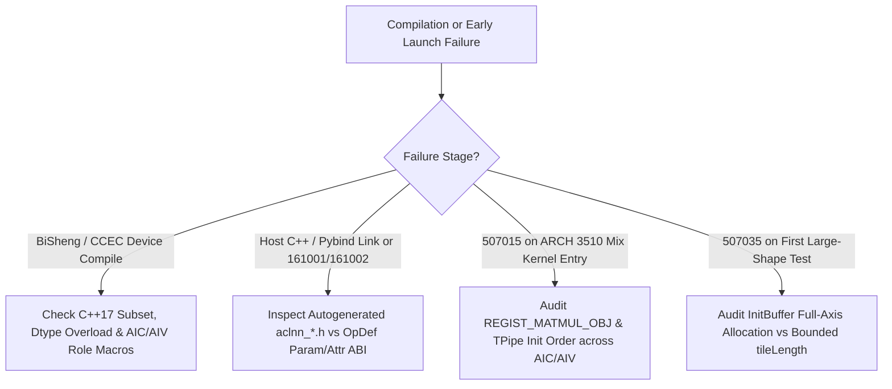

## Trigger Conditions & Symptoms

Activate this workflow when an Ascend C operator fails during `bisheng`/`ccec` compilation, C++ ST / PyTorch adapter linking, `aclnn*GetWorkspaceSize` invocation (`161001` / `161002`), or immediately faults on first launch due to compile-time structural bugs (`507015` / `507035`):

1. **Autogenerated `aclnn*.h` Signature & Scalar ABI Errors (`161001`, `161002`)**:
   - Caller passes `float`/`int64_t` where autogen expects `const aclScalar*` (or vice versa), or optional input parameters without `Optional` suffix in `OpDef` shift positional arguments in `aclnn*GetWorkspaceSize`.
2. **BiSheng Device C++ Restrictions & AIC/AIV Sub-Target Compilation Failures**:
   - Device compilation fails on `std::vector`, `std::string`, exceptions, virtual functions, or `double` (`FP64`) vector intrinsics; or an AIC-only instruction (`Mmad`, `LoadData`) is compiled into the AIV pass (or Vector `Add`/`SoftMax` into the AIC pass) without `#ifdef __DAV_C220_CUBE__` / `__DAV_C220_VEC__` / `ASCENDC_CUBE_ONLY` role guards.
3. **Compile-Time Template / `InitBuffer` Structural Time-Bombs (`507015`, `507035`)**:
   - Dead template branches or unguarded `InitBuffer(buf, fullN * sizeof(float))` compile cleanly and pass tiny smoke shapes ($N=64$), then crash with `507035` UB overflow on medium/large shapes ($N=65536$).

## Triage Decision Tree

## Step-by-Step Resolution Workflow

### Branch 1: `161001` / `161002` Autogen Header & Scalar/Optional ABI Mismatch
1. **Inspect the Generated Header Directly**:
   - Read `build_out/autogen/aclnn_<op_name>.h` immediately after compilation instead of guessing the generated C signature (`161001_autogen_scalar_aclscalar_abi_mismatch.md`, `161002_autogen_header_scalar_type_mismatch.md`).
2. **Verify `aclScalar*` vs Primitive Scalar & Optional Parameter Suffixes**:
   - Inputs declared via `this->Input("alpha").ScalarType()` generate `const aclScalar* alpha` in `aclnn*GetWorkspaceSize`, whereas attributes declared via `this->Attr("alpha").Float()` generate `float alpha` (`int64_t` for `Int()`, `bool` for `Bool()`).
   - Optional tensor inputs must use `.ParamType(Option::OPTIONAL)` (and optional pointer parameters in C++ ST wrappers must pass `nullptr` when absent; see `aclnn_header_optional_suffix_pointer_params_only.md`).
   - Verify that `OP_CHECK` conditions in `op_host/*.cpp` are not inverted (`161002_op_check_condition_inverted.md`: `OP_CHECK(cond_is_error, ..., return GRAPH_FAILED)` vs `assert(cond_is_valid)`).

### Branch 2: BiSheng Device C++ & AIC/AIV Compile-Time Role Isolation
1. **Enforce AIC vs AIV Compile-Time Isolation (`aic_aiv_role_compile_time_isolation.md`)**:
   - BiSheng compiles MIX kernels in two separate passes: one for the Cube sub-target (`__DAV_C220_CUBE__` / `__AIC__`) and one for the Vector sub-target (`__DAV_C220_VEC__` / `__AIV__`).
   - Guard Cube-only `InitBuffer` (`TPosition::A1/B1/A2/B2/CO1`) and `Mmad`/`LoadData` calls with `#if defined(__DAV_C220_CUBE__) || defined(__AIC__)` (or `if ASCEND_IS_AIC`), and guard Vector-only `InitBuffer` (`TPosition::VECIN/VECOUT/VECCALC`) and Vector APIs with `#if defined(__DAV_C220_VEC__) || defined(__AIV__)` (or `if ASCEND_IS_AIV`).
2. **Fix Arch35 (`Ascend 950`) Mix Kernel `REGIST_MATMUL_OBJ` L1 Crash (`507015_regist_matmul_obj_arch35_mix_l1_crash.md`)**:
   - On `ARCH 3510` (Ascend 950), invoking `REGIST_MATMUL_OBJ` with uninitialized or mismatched `TPipe` state across AIC/AIV roles in a MIX kernel triggers a `507015` illegal L1/workspace access crash. Ensure `TPipe pipe;` is initialized once and `REGIST_MATMUL_OBJ(&pipe, GetSysWorkSpacePtr(), ...)` follows the exact Arch35 MIX registration sequence before `op.Init(...)`.
3. **Resolve Overload Ambiguity on `bfloat16_t` & `int64_t`**:
   - Many Ascend C Vector APIs do not support direct arithmetic on `bfloat16_t` or `int64_t`; cast `bfloat16_t -> float` (`Cast<float, bfloat16_t>`) for Vector math (`D5`, `A1`), and avoid passing `size_t` / `int64_t` where APIs expect `uint32_t` / `int32_t`.

### Branch 3: Static/Full-Axis `InitBuffer` UB Overflow (`507035_per_intermediate_full_size_tbuf`)
1. **Audit Every `pipe.InitBuffer` Call Against UB Capacity**:
   - Search `op_kernel/` for `InitBuffer` calls sized by problem dimensions (`totalLength`, `rowLength`, `N`, `R0`, `A0`) instead of a bounded `tileLength` (`507035_scan_r_axis_whole_row_initbuffer.md`, `507035_float32_tile_ub.md`).
   - Also check dead/fallback template branches (`507035_dead_tpl_path_full_n_alloc.md`): if a "full-load" template branch is selected when `rowLength > maxUbTile`, `InitBuffer` overflows the 192 KB / 256 KB UB limit and faults immediately with `507035`.
2. **Fix**:
   - Gate full-row template branches strictly on `rowLength * bytesPerElem * totalBuffers <= ubSafeBytes` in Host `TilingFunc`, and route larger rows to the column-split tiled template branch.

## Verification Checklist

- [ ] `build_out/autogen/aclnn_<op>.h` parameter types and order match the caller's `aclnn*GetWorkspaceSize` invocation 1:1.
- [ ] Every `pipe.InitBuffer` byte size is bounded by a host-clamped `tileLength` (never raw `N` or `rowLen`) and rounded up to `32B`.
- [ ] Host `TilingData` struct fields match between `op_host/*_tiling.h` and `op_kernel/` with no `#ifdef` layout divergence.
