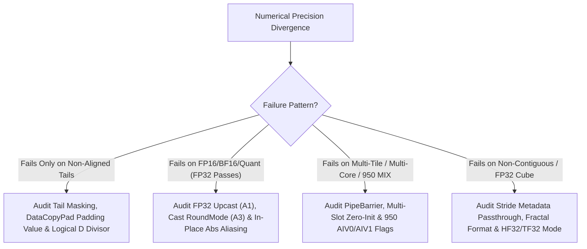

## Trigger Conditions & Symptoms

Activate this workflow when an Ascend C or CANNBot-DSL operator compiles and finishes execution without runtime error codes, but fails golden numerical verification (`max_abs_err`, `rel_err`, `cosine_similarity`, `NaN`/`Inf` mismatch, or non-deterministic run-to-run drift):

1. **Shape-Dependent Error (Aligned Shapes Pass, Non-Multiple-of-32B/64 Shapes Fail)**:
   - Indicates tail-lane garbage pollution in reductions, wrong `DataCopyPad` padding value (`0.0f` used for `ReduceMin`/`ReduceMax`), or dividing mean/variance by `alignedD` instead of logical `D`.
2. **Dtype-Dependent Error (`FP32` Passes, `FP16`/`BF16`/`INT8` Fails by $10^{-2}$ or `Inf`)**:
   - Indicates missing `FP32` intermediate upcast (`A1`), wrong `Cast` rounding mode (`CAST_NONE` / truncation instead of `CAST_RINT`, `A3`), or `FP16` intermediate overflow (`> 65504`).
3. **Core-Count / Iteration-Dependent Error (Single-Tile Passes, Multi-Tile or Multi-Core Fails)**:
   - Indicates missing `PipeBarrier<PIPE_V>()` on in-place UB reuse, uninitialized multi-slot workspace buffers (`P139`), or Ascend 950 `1:2` MIX `AIV0`/`AIV1` flag collision (`950_mix_1_2_mode_2_aiv1_flag.md`).

## Triage Decision Tree

## Step-by-Step Resolution Workflow

### Branch 1: Tail-Lane Garbage, `NaN` Propagation & Padding Contamination
1. **Check Reduction Identity Padding on `DataCopyPad` and UB Tails**:
   - When `DataCopyPad` pads an unaligned row from `blockLen` bytes to 32B in UB, `rightPadding` defaults to `0` if enabled, or leaves tail elements **uninitialized** if `isPad = false`!
   - If uninitialized UB memory contains `NaN` or large floats from a prior tile, any unmasked `Add`, `WholeReduceSum`, or `WholeReduceMax` produces `NaN` or garbage.
   - **Fix**: Set explicit `SetVectorMask` to the exact logical element count on the final repeat, or fill tail elements with `0.0f` (for `Sum`), `$-\infty$` (for `Max`), or `$+\infty$` (for `Min`).
2. **Verify `NaN` Propagation Semantics (`950_reducemin_vector_core.md`, `amin_amax_nan_direction_std_vs_numpy.md`)**:
   - Standard PyTorch/NumPy reductions propagate `NaN` (`amin([1.0, NaN]) == NaN`), whereas hardware `ReduceMin`/`ReduceMax` on Vector Core may ignore `NaN` and return `1.0`. Pre-check `Compare(nanMask, x, x, CMPMODE::NE)` when IEEE `NaN` propagation is required.

### Branch 2: Intermediate Precision (`A1`), Rounding Mode (`A3`) & In-Place Alias Traps
1. **Upcast `FP16`/`BF16` to `FP32` for Reductions & Composite Chains (`A1`)**:
   - Never accumulate `Sum`, `Mean`, `RmsNorm`, `LayerNorm`, `SoftMax`, or `SwiGLU` directly in `FP16` or `BF16`. Upcast to `FP32` via `Cast(xFp32, xIn, RoundMode::CAST_NONE, count)`, compute in `FP32`, and downcast once at the end via `Cast(yOut, yFp32, RoundMode::CAST_RINT, count)`.
2. **Eliminate Destructive In-Place Buffer Aliasing (`abs_inplace_overwrites_signed_source_before_quant.md`)**:
   - Check if `Abs(xBuf, xBuf, count)` or `Muls(xBuf, xBuf, ...)` overwrites an input UB buffer that is read again later in the same tile (e.g., computing `max(abs(x))` for dynamic quantization scale and then quantizing `xBuf`, which now has all positive values!).
   - Also check in-place vector recurrence (`x[offset] = f(x[0])`): insert `PipeBarrier<PIPE_V>()` between dependent vector steps when source and destination UB ranges overlap (`alias_hazards_and_vector_recurrence.md`).

### Branch 3: Multi-Tile / Multi-Core & Ascend 950 `1:2` MIX Synchronization Races
1. **Ascend 950 `1:2` MIX Mode Flag Separation (`950_mix_1_2_mode_2_aiv1_flag.md`)**:
   - In a `1:2` AIC:AIV MIX group (`mode = 2`), one AIC core pairs with **two** AIV sub-cores (`subBlockIdx == 0` and `subBlockIdx == 1`).
   - If only `AIV0` signals `CrossCoreSetFlag` or if both `AIV0` and `AIV1` share the same flag without waiting for `AIV1` to finish writing its half of the workspace, AIC reads half-written data on the second half of the tile!
   - **Fix**: Ensure both `AIV0` and `AIV1` synchronize their respective workspace slices (using distinct flag IDs or group-wide `CrossCoreSetFlag<0x2, PIPE_MTE3>`).
2. **Multi-Slot Ping-Pong Workspace Zero-Initialization (`P139`)**:
   - When using 2-slot or 3-slot workspace ping-pong buffers, verify that padded tail rows are zero-initialized across **all** slots, not just slot 0.

### Branch 4: Stride Metadata Loss, Internal Format Reordering & `HF32` Cube Noise
1. **Non-Contiguous View Stride Loss (`aclnn_direct_path_stride_metadata_lost.md`)**:
   - When a fast/direct kernel path assumes contiguous `rowStride = D` without checking `tensor->GetStorageShape()` / `GetStride()`, sliced or transposed input views read contiguous memory instead of strided rows. Either pass explicit per-dimension strides in `TilingData` or call `.contiguous()` before the contiguous-only kernel.
2. **`FP32` Conv/Matmul `HF32` (`TF32`) Truncation (`a5_aclnn_fp32_conv_tf32_noise_001.md`)**:
   - When an `FP32` Conv or Matmul shows `~5e-4` relative error against FP64/CPU FP32 reference, check if the Cube unit is operating in `HF32` (`TF32` 10-bit mantissa) mode (`cubeMathType = 1`). Set `SetHF32(false)` (`cubeMathType = 0`) on Ascend 950 or use `FP32-via-BF16` 3-GEMM decomposition (`P128`) on Ascend 910B.

## Verification Checklist

- [ ] Run deterministic 3-run bitwise repeatability check (`aclnn_determinism_3run_bitwise.md`) to separate race/uninitialized-memory bugs from deterministic rounding bugs.
- [ ] Test at least one prime/unaligned shape (e.g., $M=17, D=1031$) alongside aligned power-of-two shapes.
- [ ] Verify both positive and negative input distributions (catches in-place `Abs` and unsigned index cast bugs).
