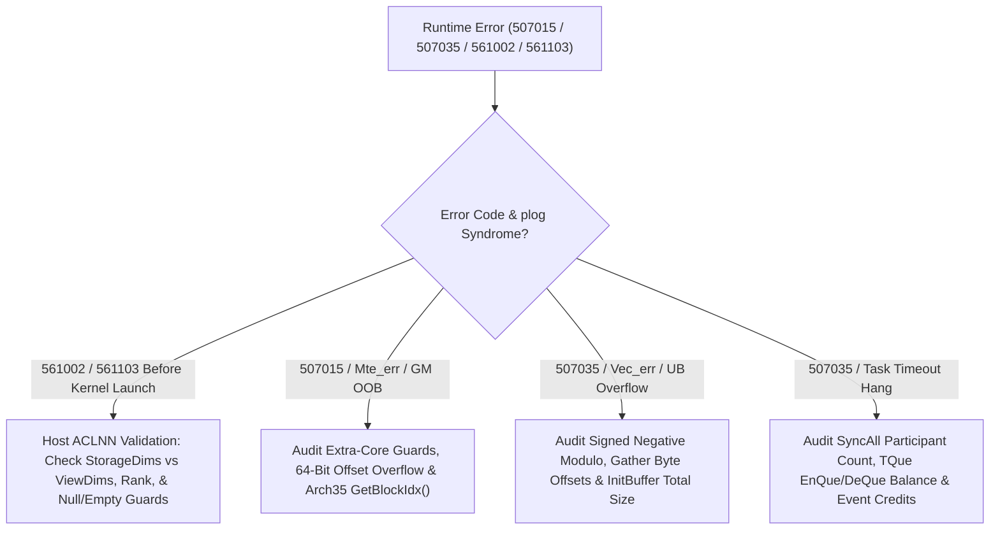

## Trigger Conditions & Symptoms

Activate this workflow when an operator execution raises `507015` (`ACL_ERROR_RT_AICORE_OVER_FLOW` / illegal GM access), `507035` (`ACL_ERROR_RT_EXCEPTION` / AICore exception or task timeout), `561002` / `561103` (ACLNN host parameter validation error), or hangs until the CANN stream watchdog kills the task:

1. **First Action — Decode the `plog` Hardware Syndrome (`507035_plog_errcode_triage.md`)**:
   - Never treat `507035` as a single error! Grep `$ASCEND_PROCESS_LOG_PATH/debug/plog/plog-*.log` (or `ASCEND_PROCESS_LOG_PATH`) for `aicore exception`, `errcode`, `pc start`, and `Mte_err` / `Vec_err` / `Bi_err`:
     - **`read_overflow` / `write_overflow` / `Mte_err` / `507015`**: Out-of-bounds GM address, negative/wrapped `uint32_t` offset, or unaligned UB offset in `DataCopy`.
     - **`vec_err` / `ub_addr_out_of_bounds`**: `InitBuffer` exceeded UB capacity, `Gather` byte offset exceeded UB buffer size, or negative modulo ring index (`(i - 1) % 2 == -1` in signed `int32_t`!).
     - **`aicore timeout` / `task timeout`**: Unmatched `WaitFlag`, `DeQue` without `EnQue`, `CrossCoreWaitFlag` deadlock, or `SyncAll()` called by only a subset of launched cores.

## Triage Decision Tree

## Step-by-Step Resolution Workflow

### Branch 1: `507015` / `Mte_err` GM Out-of-Bounds & Core Indexing Traps
1. **Unguarded Extra Cores When `totalTasks < blockDim` (`507035_unguarded_extra_cores_oob_dispatch.md`)**:
   - If Host sets `SetBlockDim(48)` when `totalRows == 10`, cores `10..47` receive `coreRows = 0` or negative remaining length (`rem = totalRows - blockIdx * perCore < 0`). Casting a negative `int32_t` length to `uint32_t` in `DataCopy` triggers an immediate `4 GB` GM read/write fault!
   - **Fix**: Either clamp `context->SetBlockDim(usedCoreNum)` on Host, or add `if (GetBlockIdx() >= tiling.usedCoreNum) return;` as the very first statement of `Process()` (before any `DataCopy`, **provided** the kernel does not call global `SyncAll()`!).
2. **Ascend 950 (`ARCH 3510`) `GetBlockIdx()` Sub-Block Double-Counting (`arch35_aiv_getblockidx_already_folds_subblock.md`)**:
   - On `ARCH 3510`, `GetBlockIdx()` inside an AIV kernel **already returns the flattened global AIV index** (`0 .. 2*aicNum - 1`). Writing `int aivId = GetBlockIdx() * GetSubBlockNum() + GetSubBlockIdx();` double-multiplies the index and accesses out-of-bounds GM on the upper half of cores!
3. **32-Bit Integer Overflow on Large Tensor Offsets**:
   - When $B \times S \times H > 2^{31} - 1$ elements, computing `int32_t offset = b * strideB + s * strideS` overflows to a negative number before `gmTensor[offset]`. Always compute global offsets in `int64_t` / `uint64_t`.

### Branch 2: `507035` UB Address Overflow & Signed Ring-Buffer Modulo Bugs
1. **Signed Negative Modulo in Ping-Pong Ring Indexing (`507035_negative_modulo_ring_index_ub_offset.md`)**:
   - In C++, `(-1) % 2` evaluates to **`-1`**, not `+1`! Writing `int prevSlot = (step - 1) % BUFFER_NUM;` at `step = 0` indexes `ubBuf[-1 * tileLen]`, faulting immediately with UB address underflow.
   - **Fix**: Always use unsigned arithmetic or `int prevSlot = (step + BUFFER_NUM - 1) % BUFFER_NUM;`.
2. **`Gather` L2 / UB Offset Overread (`507035_gather_l2_offset_overread.md`)**:
   - Check that every element of `offsetLocal` (`uint32_t`) in `Gather(dst, src, offsetLocal, ...)` is clamped to `[0, (srcLen - 1) * sizeof(T)]` *including* inactive tail lanes in the last repeat unless masked out by `mask`.

### Branch 3: `507035` Kernel Hang / Task Timeout (`507035_syncall_multicore_reduce.md`)
1. **Conditional `SyncAll()` Deadlock**:
   - If Core $i$ returns early via `if (blockIdx >= usedCoreNum) return;` while cores $0 \dots \text{usedCoreNum}-1$ call hardware `SyncAll()`, the hardware barrier waits forever for all `blockDim` launched cores!
   - **Fix**: Either set `context->SetBlockDim(usedCoreNum)` on Host so only participating cores are launched, or let idle cores skip `DataCopy`/`Compute` *without* returning early before `SyncAll()`.
2. **Intra-Core `SetFlag` / `WaitFlag` or `EnQue` / `DeQue` Imbalance**:
   - Check loops with `continue` or early exit where `AllocTensor` was called without `EnQue`/`DeQue`/`FreeTensor`, or where `WaitFlag` is called inside a loop whose matching `SetFlag` was gated by an `if` condition (`conditional_consumers_and_empty_publication.md`).

### Branch 4: `561002` / `561103` Host ACLNN Parameter & Shape Validation Failures
1. **Physical Storage Shape vs View Shape (`561103_storagedims_physical_not_view_shape.md`)**:
   - When constructing `aclCreateTensor(viewDims, viewStrides, offset, dataType, format, storageDims, ...)`, `storageDims` must describe the underlying physical allocation (not the sliced/expanded view shape), or `561103` is raised.
2. **Non-Scatter Dimension Shape Equality (`aclnn_561002_scatter_non_dim_shape_violation.md`)**:
   - In `scatter` / `gather`, verify rank equality and `index.size(d) <= src.size(d)` (or `<= self.size(d)`) on all non-scatter dimensions before calling `aclnn*`.

## Verification Checklist

- [ ] Use `ASCENDC_DUMP` / `printf` (`ascendc_printf_plog_routing.md`) or bisect `TilingFunc` (`507035_tiling_path_bisection_plog.md`) by temporarily returning early after `CopyIn` vs `Compute` vs `CopyOut` to isolate the exact pipe that faults.
- [ ] Verify that `aclrtSynchronizeStream` is called inside test harnesses (`aclnn_internal_sync_false_pass.md`) so asynchronous `507035` faults are never masked by process exit.
